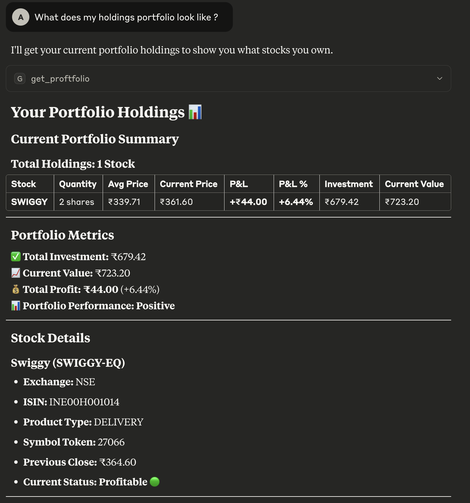
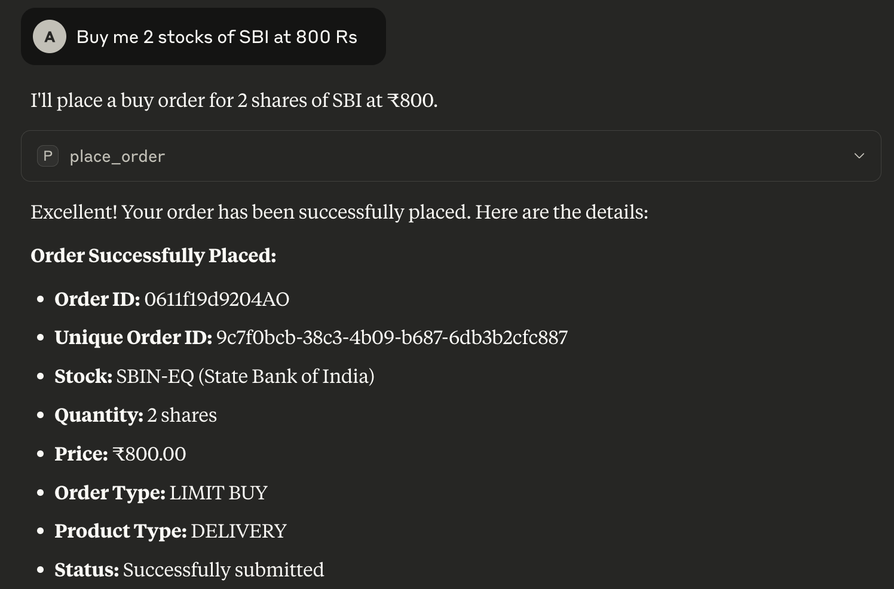
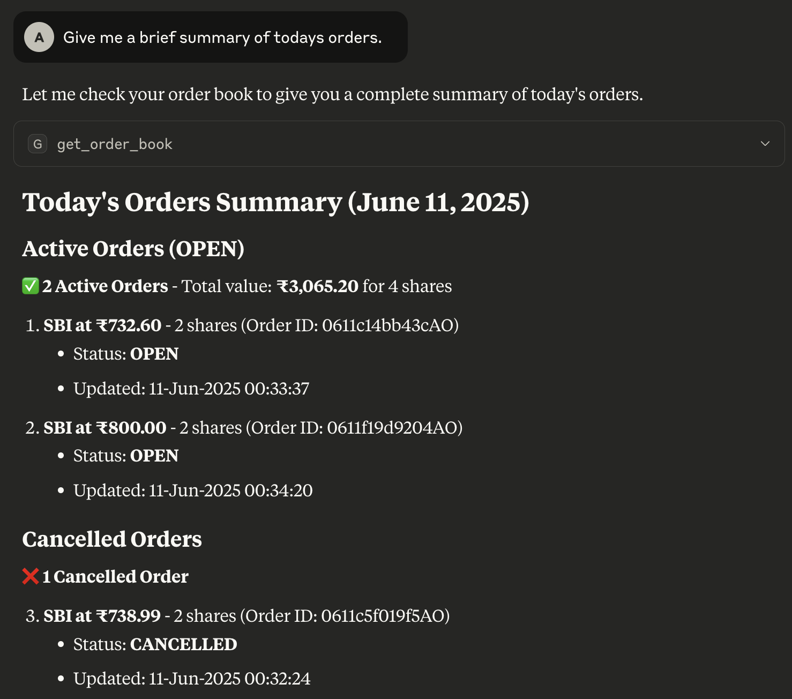

# Angel One SmartAPI MCP Server

A robust Python-based Model Context Protocol (MCP) server that integrates with Angel One's SmartAPI platform, enabling seamless trading operations and portfolio management through Claude Desktop and other MCP-compatible clients.


## 🚀 Features

- **🔐 Advanced Authentication**: Secure TOTP-based authentication with automatic session management
- **📊 Portfolio Management**: Real-time portfolio tracking and holdings analysis
- **📈 Market Data**: Historical candlestick data retrieval with multiple timeframes
- **💼 Order Management**: Complete order lifecycle - place, cancel, and track orders
- **🔄 Auto Session Recovery**: Intelligent session refresh and error recovery mechanisms


## 📋 Prerequisites

- Python 3.10+
- Active Angel One trading account with API access
- Angel One SmartAPI credentials
- Claude Desktop (for MCP integration)
- MCP CLI (for running the FastMCP server)


## 🔧 Installation

### 1. Clone the repository:
```bash
git clone <repository-url>
cd angelone-claud-mcp
```

### 2. Create and activate a Python virtual environment:
```bash
python -m venv .venvs/mcp310
source .venvs/mcp310/bin/activate  # On Unix/macOS
# or
.venvs\mcp310\Scripts\activate  # On Windows
```

### 3. Install the required dependencies:
```bash
pip install -r requirements.txt
pip install "mcp[cli]"
```

### 4. Configure Environment Variables
Create a `.env` file in the root directory:
```env
ANGEL_API_KEY=your_api_key_here
ANGEL_USERNAME=your_username_here
ANGEL_PASSWORD=your_app_pin_here 
ANGEL_TOTP_SECRET=your_totp_token_here
ANGEL_CORRELATION_ID="abcde"
```
**⚠️ Security Note**: Never commit your `.env` file to version control. Add it to your `.gitignore` file.

### 5. Install Claude Desktop:
   - Download Claude Desktop from the official website
   - Follow the installation instructions for your operating system
   - Launch Claude Desktop

### 6. Configure Claude Desktop:
   - Open Claude Desktop
   - Go to Settings
   - Add the following configuration to your `claude_desktop_config.json`:
  ```json
  {
    "mcpServers": {
      "AngelOne": {
        "command": "/path/to/your/venv/bin/mcp",
        "args": [
          "run",
          "/path/to/your/project/main.py"
        ]
      }
    }
  }
  ```
   Replace `/path/to/your/venv/bin/mcp` with the actual path to your MCP executable and `/path/to/your/project/main.py` with the actual path to your main.py file.


## 🚦 Usage Examples

The project uses FastMCP to create a server that exposes various trading functionalities. Once configured, you can interact with your Angel One account directly through Claude Desktop using natural language:

### Portfolio Management
Ask Claude: 
- "Check my portfolio"
- "Show my current holdings"
- "What's my portfolio performance today?"
- `get_proftfolio()`: Retrieves complete portfolio holdings with real-time P&L calculations.



### Market Data
Ask Claude:
- "Get candlestick data for SBIN from yesterday"
- "Show me 5-minute chart data for RELIANCE from last week"
- "Get daily candles for symbol token 3045"
- `get_candle_data(start_time, end_time, symboltoken, interval)`: Retrieves historical candlestick data
  - Parameters:
    - `start_time`: Start date and time in "YYYY-MM-DD HH:MM" format
    - `end_time`: End date and time in "YYYY-MM-DD HH:MM" format
    - `symboltoken`: The symbol token for the stock (default: "3045")
    - `interval`: Time interval for the data (e.g., "ONE_MINUTE", "FIVE_MINUTE", "ONE_DAY")


### Order Management
Ask Claude:
- "Place a buy order for 10 SBIN shares at ₹800"
- "Cancel my pending order"
- "Show me my order book"
- "What orders do I have today?"
- `place_order(symbol, symboltoken, transactiontype, quantity, ordertype, producttype, price)`: Places a new order
  - Parameters:
    - `symbol`: Trading symbol of the stock
    - `symboltoken`: Symbol token of the stock
    - `transactiontype`: "BUY" or "SELL"
    - `quantity`: Quantity to be traded
    - `ordertype`: Type of order (default: "LIMIT")
    - `producttype`: Product type (default: "DELIVERY")
    - `price`: Price at which to place the order (default: 0)



- `cancel_order(order_id, variety)`: Cancels an existing order
  - Parameters:
    - `order_id`: The order ID to cancel
    - `variety`: Order variety (default: "NORMAL")

- `get_order_book()`: Retrieves the current order book




## 📊 Available Functions

The MCP server exposes these functions to Claude:

- **`get_proftfolio()`**: Retrieves complete portfolio holdings with real-time P&L calculations
- **`get_candle_data(start_time, end_time, symboltoken, interval)`**: Fetches historical OHLC data
- **`place_order(symbol, symboltoken, transactiontype, quantity, ordertype, producttype, price)`**: Places buy/sell orders
- **`cancel_order(order_id, variety)`**: Cancels existing orders
- **`get_order_book()`**: Retrieves current order book
- **`health_check()`**: Performs system health verification


## 🔒 Security Features

- **Environment Variable Protection**: Sensitive credentials stored securely
- **TOTP Authentication**: Time-based one-time password security
- **Session Management**: Automatic session validation and renewal
- **Error Isolation**: Comprehensive exception handling prevents credential exposure


## 🤝 Contributing

Contributions are welcomed. Please follow these guidelines:

1. Fork the repository
2. Create a feature branch (`git checkout -b feature/amazing-feature`)
3. Commit your changes (`git commit -m 'Add amazing feature'`)
4. Push to the branch (`git push origin feature/amazing-feature`)
5. Open a Pull Request


## 📝 License

This project is licensed under the MIT License - see the [LICENSE](LICENSE) file for details.


## ⚠️ Disclaimer

This software is for educational and development purposes. Always verify trades and manage risk appropriately. The developers are not responsible for any financial losses incurred through the use of this software.

---

**Built with ❤️ for the trading community**